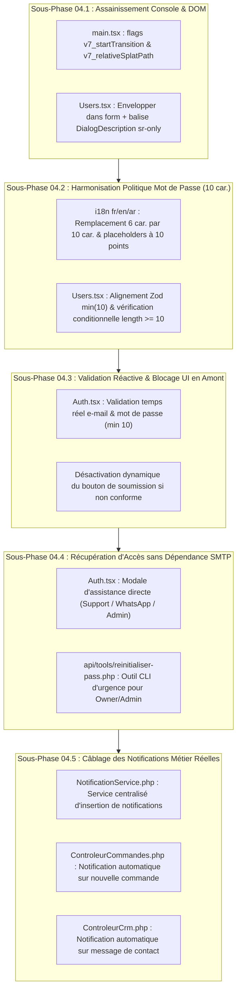

# PLAN D'IMPLÉMENTATION — PHASE 04

# Assainissement Console, Harmonisation des Politiques de Mot de Passe (10 car.), Validation Réactive, Récupération d'Accès sans SMTP & Câblage des Notifications Métier

**Projet :** KA-Tech (`amichiamine/ka-tech`)  
**Directeur & Concepteur :** ArchiSys3.0  
**Tech Lead, Architecte & R&D :** AImi  
**Date :** 20 octobre 2026  
**Statut :** Proposé — En attente de validation

---

## 1. Contexte & Problématique

Lors de la recette menée par ArchiSys3.0 sur la version de travail, 5 points de non-conformité et d'irritants d'ingénierie ont été mis en exergue :

1. **Pollution de la console navigateur :**
   - Avertissements React Router v7 future flags (`v7_startTransition`, `v7_relativeSplatPath`).
   - Warning d'accessibilité Radix UI Dialog : `Missing Description or aria-describedby={undefined} for DialogContent`.
   - Violation DOM Chromium : champ mot de passe non contenu dans une balise `<form>` dans `Users.tsx`.
2. **Incohérence des indications de mot de passe (6 car. vs 10 car.) :**
   - Le backend PHP (`api/src/Auth/MotDePasse.php`) et le schéma partagé (`src/lib/auth-schemas.ts`) imposent strictement **10 caractères minimum**.
   - Plusieurs écrans et traductions (`Users.tsx`, `fr.ts`, `en.ts`, `ar.ts`) indiquent à tort `6 caractères minimum` ou affichent des placeholders trompeurs (`••••••`), provoquant des rejets serveurs 422 inattendus lors de la saisie d'un mot de passe de 6 à 9 caractères.
3. **Absence de validation réactive en temps réel (Client-side) :**
   - Les formulaires d'authentification et d'administration attendent le clic sur le bouton de soumission pour valider, autorisant des envois de données invalides vers le backend.
4. **Parcours de mot de passe oublié trompeur & Récupération sans SMTP :**
   - Le bouton « Mot de passe oublié » dans `Auth.tsx` affiche un faux message de succès « Email envoyé » sans aucun envoi réel ni backend SMTP opérationnel.
   - Nécessité d'une procédure d'assistance directe et d'un outil de reprise d'urgence sécurisé en ligne de commande pour le Super Administrateur / Propriétaire.
5. **Absence de notifications applicatives réelles (In-App) :**
   - La table `notifications` et l'interface d'en-tête (cloche avec badge) existent mais restent désespérément muettes car aucun contrôleur métier n'insère d'événements lors de nouvelles commandes ou messages de contact.

---

## 2. Découpage Méthodique par Sous-Phases

---

## 3. Plan d'Action Chirurgical Détaillé

### Sous-Phase 04.1 — Assainissement Console & DOM

- **Fichier `src/main.tsx` :**
  - Configurer `<BrowserRouter>` avec `future={{ v7_startTransition: true, v7_relativeSplatPath: true }}`.
- **Fichier `src/pages/admin/Users.tsx` :**
  - Envelopper le contenu de `<DialogContent>` dans un `<form onSubmit={(e) => { e.preventDefault(); void save(); }}>`.
  - Ajouter `<DialogDescription className="sr-only">` décrivant la finalité de la boîte de dialogue pour satisfaire Radix UI et les normes d'accessibilité WCAG.
  - S'assurer que le champ de mot de passe dispose des attributs `autoComplete="new-password"`.

### Sous-Phase 04.2 — Harmonisation de la Règle des 10 Caractères

- **Fichiers de traduction (`src/lib/i18n/admin/reglages/{fr,en,ar}.ts`) :**
  - Mettre à jour les clés `champ_mdp_placeholder`, `champ_mdp_placeholder_modifier`, `validation_mdp_requis`, `validation_mdp_court` pour stipuler clairement `10 caractères minimum` et afficher le placeholder `••••••••••`.
- **Fichier `src/pages/admin/Users.tsx` :**
  - Aligner la contrainte Zod du mot de passe sur `.min(10)`.
  - Aligner les vérifications impératives (`length >= 10`).

### Sous-Phase 04.3 — Validation Client Réactive & Verrouillage UI

- **Fichier `src/pages/Auth.tsx` :**
  - Évaluer la validité du formulaire au fil de l'eau (Regex e-mail + mot de passe $\ge 10$ car.).
  - Désactiver le bouton de validation tant que les critères ne sont pas remplis, avec affichage d'un message d'aide contextuel en direct sous le champ (`10 caractères minimum`).

### Sous-Phase 04.4 — Récupération de Compte sans SMTP

- **Fichier `src/pages/Auth.tsx` :**
  - Remplacer le faux toast d'envoi d'e-mail par une modale ou un message clair de contact direct : invitation à contacter le support / l'administrateur avec lien direct (coordonnées d'assistance de la plateforme).
- **Création du script d'urgence CLI `api/tools/reinitialiser-pass.php` :**
  - Permet à l'administrateur système de réinitialiser le mot de passe de n'importe quel compte en ligne de commande locale :
    `php api/tools/reinitialiser-pass.php <email> <nouveau_mot_de_passe>`
  - Hachage cryptographique sécurisé (Argon2id avec repli Bcrypt via `MotDePasse::hacher`).

### Sous-Phase 04.5 — Câblage des Notifications In-App Réelles

- **Création de `api/src/Services/NotificationService.php` :**
  - Méthode `creer(Db $db, string $titre, string $corps, string $niveau = 'info', ?string $lien = null): string`.
- **Branchement dans `api/src/Controllers/ControleurCommandes.php` :**
  - Dès qu'une commande est créée avec succès, insertion d'une notification niveau `info` : « Nouvelle commande #{id} — Montant : {total} DZD » avec lien vers `/admin/commandes/{id}`.
- **Branchement dans `api/src/Controllers/ControleurCrm.php` :**
  - Dès qu'un message de contact / devis est reçu, insertion d'une notification niveau `info` : « Nouveau message de {nom} » avec lien vers `/admin/crm`.

---

## 4. Matrice de Recette & Vérification

| Test    | Cible                        | Comportement Attendu                                                                                                 |
| :------ | :--------------------------- | :------------------------------------------------------------------------------------------------------------------- |
| **T01** | Console navigateur           | Disparition intégrale des 3 warnings (Router v7, Radix DialogDescription, Password outside form)                     |
| **T02** | Formulaire Admin Users       | Refus immédiat à la saisie de mots de passe < 10 caractères avec message clair                                       |
| **T03** | Formulaire Auth Client       | Bouton de connexion/inscription bloqué si email invalide ou mdp < 10 car.                                            |
| **T04** | Outil CLI de secours         | Exécution de `reinitialiser-pass.php` met à jour le hash en base et autorise la connexion immédiate                  |
| **T05** | Flux Commande & CRM          | La création d'une commande ou d'un message incrémente le badge de la cloche admin et affiche l'élément dans la liste |
| **T06** | Intégrité TypeScript & Build | `bunx tsc --noEmit` sans erreur et `bun run build` avec génération de l'archive horodatée                            |

---

## 5. Arbitrage & Validation

ArchiSys3.0 est invité à valider ce plan d'implémentation (via le bouton « Proceed » de l'artéfact interactif ou accord formel) pour autoriser le passage en **Mode Implémentation**.
