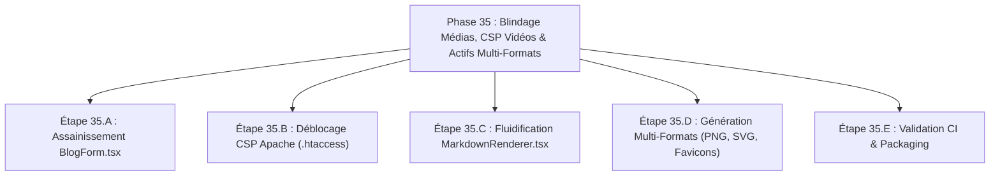

# PLAN D'IMPLÉMENTATION — PHASE 35

## Blindage Médias Blog, Déblocage CSP Vidéos (YouTube / Vimeo), Éradication des Reflows & Déclinaisons Multi-Formats (PNG, SVG, Favicons) StacGate × ArchiSys3.0

**Directeur de Projet & Architecte Décideur :** ArchiSys3.0  
**Tech Lead, Architecte & Consultant R&D :** AImi  
**Date :** 07 Novembre 2026  
**Statut :** 📋 Soumis à Validation (Attente Accord Explicite)

---

### 1. Contexte & Problématique

1. **Erreur « URL Invalide » lors de l'enregistrement d'un article de blog :**  
   Dans [`src/pages/admin/BlogForm.tsx`](file:///c:/xampp/htdocs/ka-tech/src/pages/admin/BlogForm.tsx), le champ `cover` applique une validation Zod stricte `z.string().url(...)`. Dès qu'une image est choisie depuis la médiathèque ou téléversée, le chemin retourné est relatif (ex. `/uploads/2026/11/...` ou `uploads/...`), ce qui fait échouer la validation et bloque toute publication avec le message d'erreur rouge _"URL Invalide"_.
2. **Blocage CSP Vidéos & Violation Console :**  
   Dans [`public/.htaccess`](file:///c:/xampp/htdocs/ka-tech/public/.htaccess), la politique Content Security Policy impose `frame-src 'none'; media-src 'self'`. L'intégration d'une vidéo YouTube (`https://www.youtube-nocookie.com/embed/...`, `https://www.youtube.com`) ou Vimeo dans les articles de blog Markdown déclenche un blocage navigateur bloquant l'affichage.
3. **Avertissements Navigateur de Reflow Forcé (31-32 ms) :**  
   L'insertion dynamique d'iframes dans le DOM par React sans dimensions intrinsèques stables ni `loading="lazy"` interrompt le flux de rendu Chromium et génère des violations de performance (`Forced reflow`).
4. **Déclinaisons Multi-Formats Absentes (Observation ArchiSys3.0) :**  
   En Phase 34, seul le format `.webp` du logo combiné a été produit. Les déclinaisons sœurs haute fidélité (`stacgate-archisys-combined.png`, `stacgate-archisys-combined.svg`) ainsi que l'harmonisation des icônes d'application (`favicon.ico`, `favicon.svg`, `apple-touch-icon.png`, `icone-192.png`, `icone-512.png`) doivent être générées pour assurer une complétude 360° du branding officiel.

---

### 2. Matrice d'Intervention Chirurgicale

---

### 3. Détail des Actions par Étape

#### Étape 35.A — Assainissement de la Validation des Médias de Couverture (`BlogForm.tsx`)

- Remplacer le validateur Zod monolithique `.url(...)` par un schéma tolérant les chemins relatifs et souverains :
  - Chemins locaux relatifs (`/uploads/...`, `uploads/...`, `/media/...`, `/assets/...`).
  - URLs absolues externes sécurisées (`https://...`, `http://...`).
  - Schémas data (`data:image/...`).
  - Extensions graphiques web certifiées (`.png`, `.jpg`, `.jpeg`, `.webp`, `.svg`, `.gif`, `.avif`).
  - Chaîne vide ou `undefined` lorsque l'image est facultative.
- Aligner également le champ d'insertion vidéo de [`src/components/admin/MarkdownEditor.tsx`](file:///c:/xampp/htdocs/ka-tech/src/components/admin/MarkdownEditor.tsx) pour accepter sans blocage les URLs YouTube, Vimeo et chemins relatifs de vidéos MP4/WebM locales (`/uploads/...`).

#### Étape 35.B — Déblocage Contrôlé de la Directive CSP dans `public/.htaccess` & `dist/.htaccess`

- Mettre à jour l'en-tête Content Security Policy :
  - Remplacer `frame-src 'none'` par :  
    `frame-src 'self' https://www.youtube.com https://www.youtube-nocookie.com https://player.vimeo.com;`
  - Remplacer `media-src 'self'` par :  
    `media-src 'self' blob: data: https:;`
- Garantir le maintien de tous les autres verrous stricts (`default-src 'self'`, `object-src 'none'`, `frame-ancestors 'none'`, etc.).

#### Étape 35.C — Éradication des Reflows Forcés (`MarkdownRenderer.tsx`)

- Sur toutes les balises `<iframe>` (YouTube et Vimeo) :
  - Ajouter l'attribut natif `loading="lazy"`.
  - Fixer des dimensions de ratio stables (`aspect-video w-full`) avec `style={{ contentVisibility: 'auto' }}` pour éviter toute rupture de layout lors de l'insertion DOM.
- Sur les balises `<video>` directes :
  - Ajouter `preload="metadata"` pour différer le chargement du flux lourd.

#### Étape 35.D — Génération Multi-Formats Complète du Branding Officiel StacGate × ArchiSys3.0

- Mettre à jour [`scripts/generer-actifs-marque.ts`](file:///c:/xampp/htdocs/ka-tech/scripts/generer-actifs-marque.ts) :
  1. Génération de **`stacgate-archisys-combined.png`** (760 × 160 px, PNG 32-bit transparent haute fidélité) dans `src/assets/` et `public/media/`.
  2. Génération de **`stacgate-archisys-combined.svg`** (vectoriel autonome intégrant le graphisme, les dégradés néon et les logos en haute résolution) dans `src/assets/` et `public/media/`.
  3. Génération d'un **Favicon Hybride & Icônes Applicatives** :
     - `public/favicon.svg` intégrant l'emblème avec la pastille de souveraineté ArchiSys3.0.
     - `public/favicon.ico` régénéré en multi-tailles (16, 32, 48 px).
     - `public/apple-touch-icon.png` (180 × 180 px), `public/icone-192.png` et `public/icone-512.png`.
- Exécuter `bun scripts/generer-actifs-marque.ts` pour actualiser l'intégralité des fichiers graphiques.

#### Étape 35.E — Contrôles Qualité CI, Traçabilité & Packaging Déployable

- Exécuter la suite complète de validation :
  - `bun run verifier-i18n` (100% de parité trilingue FR/EN/AR).
  - `bun run format` (Prettier).
  - `bun run lint` (ESLint 0 erreur).
  - `bunx tsc --noEmit` (TypeScript 0 erreur).
  - `bun run build` (Build Vite, prérendu SEO Playwright & archive `katech-site-*.zip`).
  - `bun run paqueter:data` (`katech-data-*.zip`).
- Mettre à jour le journal officiel [`.agents/tracabilites.md`](file:///c:/xampp/htdocs/ka-tech/.agents/tracabilites.md).
- Committer et pousser sur `origin/main`.

---

### 4. Matrice de Recette & Critères d'Acceptance

|   ID   | Test Opérationnel                                                                                                   | Résultat Attendu                                                                                |
| :----: | :------------------------------------------------------------------------------------------------------------------ | :---------------------------------------------------------------------------------------------- |
| **T1** | Téléverser une image de couverture dans un article de blog et cliquer "Enregistrer" ou "Publier"                    | Succès immédiat, zéro erreur rouge "URL Invalide", persistance en base.                         |
| **T2** | Insérer une vidéo YouTube (`https://www.youtube.com/watch?v=...` ou `https://youtu.be/...`) dans l'éditeur Markdown | Aperçu et affichage fluides sur l'article sans avertissement ni blocage CSP `frame-src 'none'`. |
| **T3** | Contrôle console DevTools lors du chargement d'un article avec vidéo                                                | Disparition des violations `Forced reflow` grâce au lazy loading et dimensions isolées.         |
| **T4** | Vérification du dossier `public/` et `src/assets/`                                                                  | Présence effective des formats `.png`, `.svg`, `.webp` et des icônes/favicons régénérés.        |
| **T5** | Pipeline CI de validation                                                                                           | Build vert, 0 erreur TypeScript, 0 erreur ESLint, ZIPs horodatés régénérés.                     |
