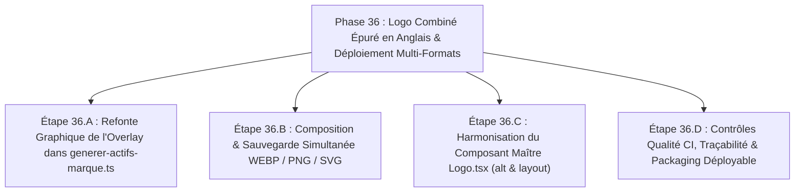

# PLAN D'IMPLÉMENTATION — PHASE 36

## Refonte Épurée du Logo Combiné Officiel en Anglais (Référence Directe Signature ArchiSys3.0) & Déploiement Multi-Formats 360°

**Directeur de Projet & Architecte Décideur :** ArchiSys3.0  
**Tech Lead, Architecte & Consultant R&D :** AImi  
**Date :** 07 Novembre 2026  
**Statut :** 📋 Soumis à Validation (Attente Accord Explicite)

---

### 1. Contexte & Enjeux de Conception

1. **Épuration Visuelle & Suppression de la Redondance :**  
   Actuellement, le logo combiné horizontal contient le mot _"ArchiSys3.0"_ écrit en gros caractères au centre, tandis que la signature officielle ArchiSys3.0 située à droite contient déjà ce même nom et son emblème. Cette répétition surcharge inutilement la composition et réduit l'espace disponible.
2. **Internationalisation en Anglais :**  
   ArchiSys3.0 a exigé le passage du texte descriptif d'accréditation en anglais international :
   - Remplacer _"CONÇU & VALIDÉ PAR"_ par **`DESIGNED & VALIDATED BY`**.
   - Remplacer _"DIRECTION TECHNIQUE & R&D"_ par **`TECHNICAL DIRECTION & R&D`**.
3. **Référence Directe au Sceau Graphique :**  
   Le texte d'accréditation doit pointer et faire référence **directement et visuellement au sceau signature officiel**, permettant d'agrandir la signature haute résolution, de lui offrir une capsule contrastée plus spacieuse et d'obtenir une signature visuelle luxueuse, moderne et internationale.
4. **Cohérence Multi-Formats Intégrale :**  
   Régénération coordonnée de l'ensemble des déclinaisons :
   - `.webp` (léger pour le bundle de production Vite).
   - `.png` (32-bit transparent haute fidélité).
   - `.svg` (vectoriel autonome haute résolution avec graphismes intégrés en base64).
   - Favicons & icônes mobiles (`favicon.ico`, `favicon.svg`, `apple-touch-icon.png`, `icone-192.png`, `icone-512.png`).

---

### 2. Matrice d'Intervention

---

### 3. Détail des Actions par Étape

#### Étape 36.A — Refonte de la Composition dans `scripts/generer-actifs-marque.ts`

- Réagencer géométriquement l'actif horizontal 760 × 160 px :
  - **À gauche :** Emblème officiel StacGate Platform (130 × 130 px, transparent).
  - **Zone centrale marque :** Titre `STACGATE` (blanc pur, lettrage 1.2) et sous-titre `PLATFORM` (cyan `#38bdf8`, lettrage 2.8).
  - **Séparateur néon :** Trait vertical fin à gradient subtil (`#3b82f6` vers `#8b5cf6`).
  - **Zone accréditation en anglais :**
    - Ligne 1 : `DESIGNED & VALIDATED BY` (Slate `#94a3b8`, lettrage 1.8, taille 11px).
    - Ligne 2 : `TECHNICAL DIRECTION & R&D` (Cyan `#38bdf8`, lettrage 1.4, taille 10px).
  - **À droite :** La signature officielle ArchiSys3.0 agrandie (140 × 140 px), encapsulée dans son médaillon sombre luxueux (`#080c14` vers `#05070b`) à coins arrondis et bordure néon à dégradé progressif.

#### Étape 36.B — Génération Parallèle Multi-Formats et Multi-Dossiers

- Générer automatiquement :
  1. `src/assets/stacgate-archisys-combined.webp` & `public/media/stacgate-archisys-combined.webp`.
  2. `src/assets/stacgate-archisys-combined.png` & `public/media/stacgate-archisys-combined.png`.
  3. `src/assets/stacgate-archisys-combined.svg` & `public/media/stacgate-archisys-combined.svg`.
  4. Mise à niveau du `public/favicon.svg` et `public/favicon.ico`.

#### Étape 36.C — Harmonisation du Composant Maître (`Logo.tsx`)

- Mettre à jour l'attribut `alt` dans [`src/components/Logo.tsx`](file:///c:/xampp/htdocs/ka-tech/src/components/Logo.tsx) pour refléter l'appellation officielle :  
  `altText = storeName + " — Designed & Validated by ArchiSys3.0"`
- Vérifier que le rendu s'affiche avec une netteté irréprochable sur tous les formats d'écran (mobile `h-8`, navbar desktop `h-9` à `h-10`, footer `h-12`).

#### Étape 36.D — Contrôles Qualité CI, Traçabilité & Packaging Déployable

- `bun run verifier-i18n` (parité trilingue FR/EN/AR).
- `bun run format` (Prettier).
- `bun run lint` (ESLint 0 erreur).
- `bunx tsc --noEmit` (TypeScript 0 erreur).
- `bun run build` (Build Vite avec prérendu Playwright & archive `katech-site-*.zip`).
- `bun run paqueter:data` (`katech-data-*.zip`).
- Mise à jour du journal officiel [`.agents/tracabilites.md`](file:///c:/xampp/htdocs/ka-tech/.agents/tracabilites.md).
- Commit & push sur `origin/main`.

---

### 4. Matrice de Recette & Critères d'Acceptance

|   ID   | Test Opérationnel                             | Résultat Attendu                                                                                                                   |
| :----: | :-------------------------------------------- | :--------------------------------------------------------------------------------------------------------------------------------- |
| **T1** | Rendu visuel dans le Header desktop et mobile | Texte en anglais `"DESIGNED & VALIDATED BY"` orienté directement vers la signature officielle ArchiSys3.0 sans mention redondante. |
| **T2** | Vérification des fichiers physiques           | Présence effective et synchronisée des 3 formats (`.webp`, `.png`, `.svg`) dans `src/assets/` et `public/media/`.                  |
| **T3** | Affichage thèmes Dark & Light                 | Lisibilité et contraste parfaits grâce à la capsule néon transparente.                                                             |
| **T4** | Pipeline CI                                   | 0 erreur TypeScript, 0 erreur ESLint, ZIPs de production horodatés créés.                                                          |
