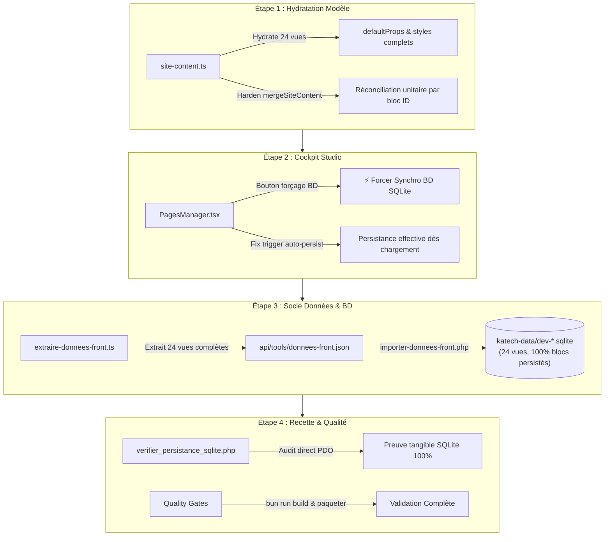

# Plan 51 : Grand Verrouillage Souverain de Persistance SQLite 360°, Hydratation Intégrale des Blocs et Synchronisation Universelle

## 1. Contexte & Problématique Résolue

L'audit chirurgical de la persistance SQLite a mis en lumière 5 angles morts critiques :

1. **9 vues sur 24 sont absentes de la base SQLite physique** (`katech-data/dev-*.sqlite`) : elles n'existaient qu'en mémoire frontend et n'étaient jamais injectées dans la table `site_content`.
2. **Tous les blocs en base étaient des coquilles vides** : `props: {}` et `style: {}` au lieu de contenir les données initiales réelles.
3. **Le trigger d'auto-persistance initiale dans `PagesManager.tsx` était court-circuité** car `mergeSiteContent` injectait en amont les pages par défaut en mémoire, rendant `hasMissing = false`.
4. **Désynchronisation entre les sections maîtresses (`hero`, `about`, `contact`...) et `customPages`**.
5. **`api/tools/donnees-front.json` datait de la Phase 41** et n'embarquait ni les 24 vues ni les propriétés riches des blocs pour l'amorçage usine de la base de données.

---

## 2. Objectifs d'Ingénierie de la Phase 51

- 🎯 **Hydratation Exhaustive 100% Blocs & Vues** : Chaque bloc des 24 vues dans [`src/lib/site-content.ts`](file:///c:/xampp/htdocs/ka-tech/src/lib/site-content.ts) est instancié avec ses `props` et son `style` complets issus du registre officiel.
- 🎯 **Réconciliation Profonde & Anti-Écrasement** : [`mergeSiteContent`](file:///c:/xampp/htdocs/ka-tech/src/lib/site-content.ts) fusionne bloc par bloc en préservant toutes les modifications utilisateur existantes tout en comblant les props manquantes.
- 🎯 **Amorçage & Persistance Directe SQLite** : Correction dans [`PagesManager.tsx`](file:///c:/xampp/htdocs/ka-tech/src/pages/admin/PagesManager.tsx) pour forcer l'écriture immédiate des 24 vues complètes dans la table SQLite `site_content`.
- 🎯 **Bouton d'Action Souveraine dans le Studio** : Ajout d'une commande explicite `[ ⚡ Forcer Synchronisation BD SQLite 360° ]` avec retour haptique/toast et indicateur d'état temps réel.
- 🎯 **Actualisation Usine & Extracteur** : Mise à jour de [`scripts/extraire-donnees-front.ts`](file:///c:/xampp/htdocs/ka-tech/scripts/extraire-donnees-front.ts), régénération d'[`api/tools/donnees-front.json`](file:///c:/xampp/htdocs/ka-tech/api/tools/donnees-front.json) et ré-injection dans [`katech-data/dev-*.sqlite`](file:///c:/xampp/htdocs/ka-tech/katech-data).
- 🎯 **Banc de Vérification & Recette Automatisée** : Script de contrôle direct SQLite inspectant octet par octet la persistance physique des 24 vues, blocs, props et styles.

---

## 3. Matrice des Interventions Chirurgicales

---

## 4. Découpage des Étapes d'Exécution

### Étape 1 : Hydratation Complète des Blocs dans `site-content.ts`

- Associer à chaque bloc de `seedCustomPages()` ses propriétés initiales explicites complètes (titres, textes, drapeaux, styles d'espacement et alignements) afin d'éliminer toute dépendance à des objets vides `{}`.
- Sécuriser `mergeSiteContent` pour effectuer un merge profond au niveau de chaque bloc : si un bloc existe déjà en base, ses props modifiées sont conservées ; si de nouveaux champs apparaissent, ils sont injectés sans écraser l'existant.

### Étape 2 : Trigger d'Auto-Persistance & Bouton de Synchronisation Forcée dans `PagesManager.tsx`

- Fiabiliser l'effet d'initialisation pour vérifier si la base SQLite contient bien toutes les vues et blocs complets. Si un différentiel est détecté, déclencher la persistance immédiate sans attendre d'action manuelle.
- Implanter dans l'en-tête du Studio (à côté de "Aperçu Direct" et "Enregistrer") le bouton d'ingénierie :  
  `[ ⚡ Synchro BD SQLite 360° ]` avec toast de confirmation du nombre de vues et blocs synchronisés.

### Étape 3 : Régénération de l'Extracteur & Ré-injection Directe SQLite

- Exécuter [`scripts/extraire-donnees-front.ts`](file:///c:/xampp/htdocs/ka-tech/scripts/extraire-donnees-front.ts) pour générer un [`api/tools/donnees-front.json`](file:///c:/xampp/htdocs/ka-tech/api/tools/donnees-front.json) immaculé contenant les 24 vues intégrales.
- Exécuter [`api/tools/importer-donnees-front.php`](file:///c:/xampp/htdocs/ka-tech/api/tools/importer-donnees-front.php) ciblant `katech-data/dev-a97b6b98a368.sqlite` pour graver immédiatement toutes les données sur le disque.

### Étape 4 : Banc d'Essai & Preuve Directe SQLite

- Exécuter un script d'audit PDO qui décompte les vues, liste chaque bloc, et valide la présence physique des champs `props` et `style` dans `site_content`.

### Étape 5 : Batterie Complète des Quality Gates & Traçabilité

- `bun run verifier-i18n`
- `bunx tsc --noEmit`
- `bun run format`
- `bun run lint`
- `bun run build`
- `bun run paqueter:data`
- Mise à jour du journal [`tracabilites.md`](file:///c:/xampp/htdocs/ka-tech/.agents/tracabilites.md) (Phase 51, parité 1:1).
- Commit & push vers `origin/main`.

---

## 5. Critères d'Acceptation & Matrice de Recette

| N°         | Vérification / Livrable                       | Résultat Attendu                                                                             |
| :--------- | :-------------------------------------------- | :------------------------------------------------------------------------------------------- |
| **REC-01** | Nombre de vues en base SQLite                 | Exactement **24 vues** présentes dans `site_content.customPages` de `dev-*.sqlite`.          |
| **REC-02** | Contenu des blocs en base SQLite              | 100% des blocs ont leurs champs `props` et `style` renseignés avec leurs valeurs explicites. |
| **REC-03** | Auto-persistance au chargement                | Si une nouvelle vue ou bloc est ajouté, la base SQLite est mise à jour immédiatement.        |
| **REC-04** | Bouton Forcer Synchro BD SQLite               | Actionnable en 1 clic depuis le Studio avec notification toast de succès confirmée.          |
| **REC-05** | Données d'installation (`donnees-front.json`) | Régénéré avec les 24 vues complètes et synchronisé avec SQLite.                              |
| **REC-06** | Quality Gates & Build                         | 100% verts (`verifier-i18n`, `tsc`, `lint`, `format`, `build`, `paqueter:data`).             |
