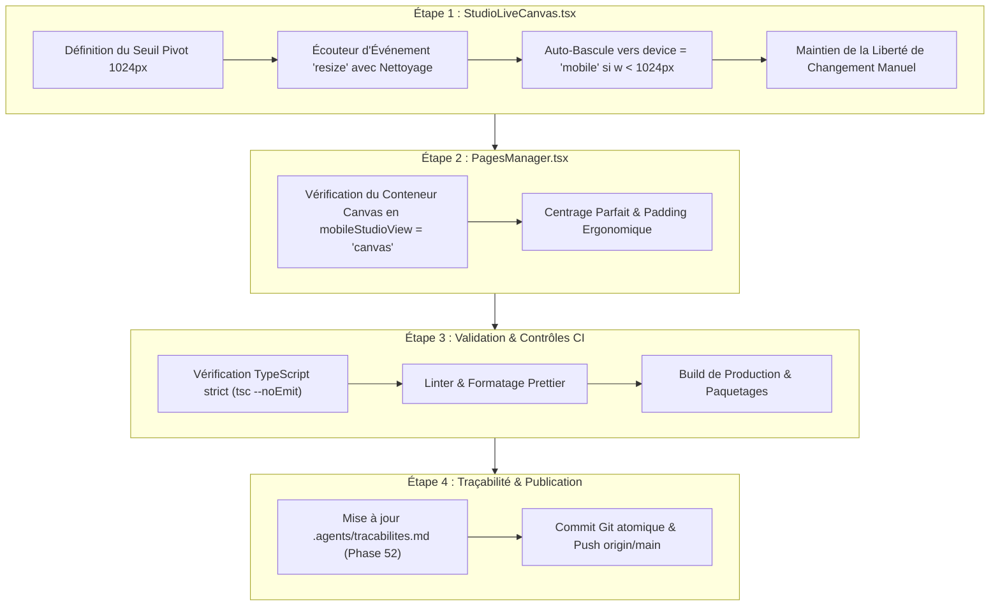

# PLAN D'IMPLÉMENTATION PHASE 52

## Auto-Bascule Réactive de l'Aperçu Live Studio en Mode Mobile pour Tailles Mobile & Tablette (< 1024px) avec Écouteur Dynamique de Redimensionnement

**Projet Hôte :** `ka-tech`  
**Directeur de Projet & Architecte Décideur :** ArchiSys3.0  
**Tech Lead, Architecte & Consultant R&D :** AImi  
**Mode :** 📋 Plan  
**Statut :** En attente de validation  
**Date :** 08/11/2026

---

## 1. Contexte & Problématique Métier

Dans le cadre du Studio Visuel 360°, lorsqu'un administrateur consulte l'interface sur un terminal compact (smartphone ou tablette, c'est-à-dire une largeur d'écran `< 1024px`) ou simule ces formats via les outils de développement :

1. **Défaut de configuration :** Le composant [`StudioLiveCanvas.tsx`](file:///c:/xampp/htdocs/ka-tech/src/components/admin/StudioLiveCanvas.tsx) sélectionnait précédemment le mode `"tablet"` (768px de large) pour les résolutions comprises entre 640px et 1023px, provoquant un débordement ou un affichage inadapté sur iPad et tablettes.
2. **Absence d'écouteur dynamique :** Le hook `useEffect` ne s'exécutait qu'une seule fois au montage initial (`[]`), sans écouter l'événement `resize` du navigateur. Toute rotation d'écran (portrait $\leftrightarrow$ paysage) ou redimensionnement de fenêtre laissait le canvas dans son mode figé.
3. **Exigence d'ArchiSys3.0 :** En taille mobile ET tablette (< 1024px), le Live Aperçu doit passer automatiquement en taille d'affichage de l'aperçu mobile (`device = "mobile"`, largeur simulée de 375px centrée).

---

## 2. Découpage Chirurgical des Travaux

### Étape 1 : Refonte de la Détection et Écouteur Réactif dans `StudioLiveCanvas.tsx`

- **Chemin :** [`src/components/admin/StudioLiveCanvas.tsx`](file:///c:/xampp/htdocs/ka-tech/src/components/admin/StudioLiveCanvas.tsx)
- **Actions :**
  1. Remplacer l'effet statique de montage par un effet réactif doté d'un écouteur `resize` (`window.addEventListener("resize", ...)`).
  2. Mémoriser la catégorie de breakpoint (`isCompact: w < 1024px`) à l'aide d'une référence (`useRef`) pour détecter les franchissements réels de seuil.
  3. Lorsque `w < 1024px` (mobile et tablette) : forcer automatiquement `setDevice("mobile")`.
  4. Lorsque l'écran passe de compact à large (`w >= 1024px`) : restaurer `setDevice("desktop")`.
  5. Assurer le nettoyage complet de l'écouteur dans la fonction de retour du `useEffect` (`return () => window.removeEventListener("resize", ...)`).
  6. Conserver la possibilité pour l'utilisateur de cliquer manuellement sur les boutons de sélection d'appareil dans la barre d'outils s'il le souhaite, sans que l'état ne saute à chaque scroll ou micro-variation.

### Étape 2 : Optimisation du Conteneur et de l'Expérience Visuelle dans `PagesManager.tsx`

- **Chemin :** [`src/pages/admin/PagesManager.tsx`](file:///c:/xampp/htdocs/ka-tech/src/pages/admin/PagesManager.tsx)
- **Actions :**
  1. S'assurer que le conteneur du canvas en mode `mobileStudioView === "canvas"` offre un défilement vertical fluide et un centrage parfait du simulateur smartphone 375px.
  2. Vérifier que la barre de navigation mobile du Studio (Arborescence / Aperçu / Inspecteur) conserve une fluidité absolue.

### Étape 3 : Validation Qualité & Pipeline de Build

- **Commandes :**
  1. `bun run verifier-i18n` : Vérification des chaînes i18n trilingues.
  2. `bunx tsc --noEmit` : Contrôle strict TypeScript (zéro erreur).
  3. `bun run format` & `bun run lint` : Respect des standards Prettier & ESLint.
  4. `bun run build` : Vérification du build Vite de production.
  5. `bun run paqueter:data` : Actualisation du bundle SQLite d'archive.

### Étape 4 : Traçabilité Officielle & Livraison Git

- **Actions :**
  1. Mettre à jour [`file:///c:/xampp/htdocs/ka-tech/.agents/tracabilites.md`](file:///c:/xampp/htdocs/ka-tech/.agents/tracabilites.md) en créant l'entrée **Phase 52** avec parité stricte 1:1.
  2. Committer avec signature conventionnelle et pousser sur `origin/main`.

---

## 3. Matrice de Recette & Critères de Succès

| Test / Scénario                                                       | Comportement Attendu                                                                                   | Statut   |
| :-------------------------------------------------------------------- | :----------------------------------------------------------------------------------------------------- | :------- |
| **Chargement sur Mobile (< 640px)**                                   | Le Live Canvas s'ouvre directement avec `device = "mobile"` (375px centré).                            | À tester |
| **Chargement sur Tablette (640px à 1023px)**                          | Le Live Canvas s'ouvre directement avec `device = "mobile"` (375px centré).                            | À tester |
| **Chargement sur Desktop (>= 1024px)**                                | Le Live Canvas s'ouvre directement avec `device = "desktop"` (100% largeur fluide).                    | À tester |
| **Redimensionnement dynamique Desktop $\rightarrow$ Tablette/Mobile** | Dès que la largeur passe sous les 1024px, le canvas bascule automatiquement en mode `"mobile"`.        | À tester |
| **Redimensionnement dynamique Mobile $\rightarrow$ Desktop**          | Dès que la largeur repasse au-dessus de 1024px, le canvas bascule automatiquement en mode `"desktop"`. | À tester |
| **Nettoyage de l'écouteur**                                           | Zéro fuite mémoire au démontage du composant.                                                          | À tester |
| **Pipeline CI & Build**                                               | `tsc`, `lint`, `build` passent à 100% avec zéro avertissement bloquant.                                | À tester |
