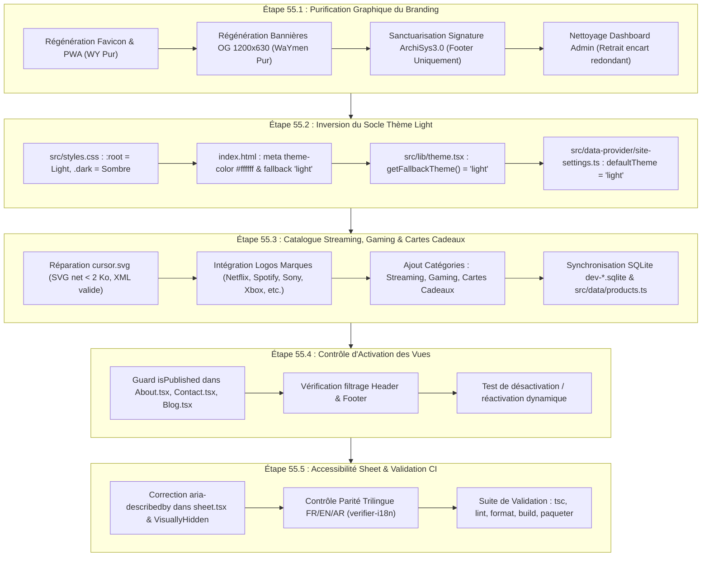

# PLAN D'IMPLÉMENTATION — PHASE 55

## Thème Light Natif, Purification Graphique du Branding, Extension Universelle du Catalogue & Gouvernance des Vues

**Projet :** WaYmen AI Studio  
**Directeur de Projet & Architecte Décideur :** ArchiSys3.0  
**Tech Lead, Architecte & Consultant R&D :** AImi  
**Date :** 22 Novembre 2026  
**Statut :** 📋 Soumis à Validation (Mode Plan)

---

## 1. Contexte & Objectifs Stratégiques

Cette phase 55 acte les arbitrages d'ingénierie et de design validés par ArchiSys3.0 pour parachever l'expérience utilisateur, l'architecture front-end et le catalogue universel de WaYmen :

1. **Branding Pur & Règle d'Or de la Signature :** Éradication absolue de toute combinaison d'images résiduelle en dehors du footer. La signature ArchiSys3.0 doit résider **exclusivement dans le footer du site**, avec sa formule officielle _"Fait avec passion & ❤️ par ArchiSys3.0"_ et son insigne discret. Les bannières, favicons, icônes PWA et tableaux de bord redeviennent 100% purs WaYmen.
2. **Thème Light Natif (au socle et non en surcouche) :** Inversion fondamentale de la cascade CSS : la pseudo-classe `:root` portera nativement le thème clair, et `.dark` constituera la variante sombre. Synchronisation du script d'amorçage 0 ms et des fallbacks système.
3. **Réparation & Uniformisation des Logos de Marques :** Correction immédiate du logo `cursor.svg` (namespace XML corrompu et taille disproportionnée de 1,5 Mo) et intégration de conteneurs badges adaptatifs pour un contraste optimal en thème clair et sombre.
4. **Extension Universelle du Catalogue (Streaming, Gaming, Cartes Cadeaux) :** Création de 3 nouveaux univers marchands avec leurs marques officielles, logos vectoriels propres, fiches produits riches et intégration synchrone en base SQLite et mock universel.
5. **Gouvernance Complète des Vues & Guard 404 :** Garantir que toute page (profil/cv, réalisations, blog, contact, à propos, etc.) désactivée depuis le panel d'administration (`/admin/pages`) disparaisse de la navigation et renvoie immédiatement un statut 404 en cas de visite directe de son URL.
6. **Éradication des Logs Console Radix UI :** Résorption définitive du warning `sheet.tsx:63 Warning: Missing Description or aria-describedby={undefined} for {DialogContent}`.

---

## 2. Découpage Chirurgical des Travaux

---

### Sous-Phase 55.1 : Purification Graphique & Sanctuarisation de la Signature

- [ ] Modifier `scripts/generer-actifs-marque.ts` pour générer :
  - `public/favicon.svg` : emblème WY WaYmen pur avec dégradé cyan/rose sans aucune signature incrustée.
  - `public/favicon.ico` et icônes PWA (`icone-512.png`, `icone-192.png`, `apple-touch-icon.png`) 100% WaYmen.
  - `public/og-image.png`, `src/assets/waymen-og-banner.webp`, `public/media/waymen-og-banner.webp` : bannière de prestige WaYmen AI Studio 100% épurée (suppression de l'encart latéral de signature).
- [ ] Retirer l'encart d'architecture en bas de page dans [`src/pages/admin/Dashboard.tsx`](file:///c:/xampp/htdocs/waymen/src/pages/admin/Dashboard.tsx).
- [ ] Vérifier que la signature ArchiSys3.0 reste affichée avec fierté, finesse et élégance **uniquement dans le footer** de [`src/components/Footer.tsx`](file:///c:/xampp/htdocs/waymen/src/components/Footer.tsx).

---

### Sous-Phase 55.2 : Inversion du Socle CSS vers le Thème Light Natif

- [ ] Réorganiser [`src/styles.css`](file:///c:/xampp/htdocs/waymen/src/styles.css) :
  - Définir dans `:root` les variables du thème clair (`--background: oklch(0.99 0.003 260)`, `--foreground: oklch(0.18 0.014 260)`, etc.).
  - Définir dans `.dark` les variables du thème sombre (`--background: oklch(0.16 0.012 260)`, etc.).
  - Conserver la classe utilitaire `.light` pour compatibilité si nécessaire.
- [ ] Mettre à jour [`index.html`](file:///c:/xampp/htdocs/waymen/index.html) :
  - `<meta name="theme-color" content="#ffffff" />`.
  - Fallback par défaut du script bootstrap 0 ms : `var themeToApply = userTheme || s.defaultTheme || "light";`.
- [ ] Mettre à jour [`src/lib/theme.tsx`](file:///c:/xampp/htdocs/waymen/src/lib/theme.tsx) : fallback par défaut réglé sur `"light"`.
- [ ] Mettre à jour [`src/data-provider/site-settings.ts`](file:///c:/xampp/htdocs/waymen/src/data-provider/site-settings.ts) : `defaultTheme: "light"`.

---

### Sous-Phase 55.3 : Logos de Marques & Expansion du Catalogue Universel

- [ ] **Correction de `cursor.svg` :** Remplacement par un tracé SVG vectoriel officiel, propre, inférieur à 2 Ko, doté de balises conformes XML sans `xlink` orphelin.
- [ ] **Ajout des marques et logos officiels :**
  - Streaming : `netflix.svg`, `spotify.svg`, `youtube.svg`, `disney.svg`, `apple.svg`, `amazon.svg`.
  - Gaming & Consoles : `playstation.svg`, `xbox.svg`, `steam.svg`, `nintendo.svg`, `eaplay.svg`.
  - Cartes Cadeaux : `googleplay.svg`, `razer.svg`.
- [ ] **Ajout des 3 nouvelles catégories :**
  1. `streaming-medias` : Streaming & Médias (Abonnements Netflix 4K, Spotify Famille/Individuel, YouTube Premium, Disney+).
  2. `gaming-consoles` : Gaming & Consoles / PC (PlayStation Plus, Xbox Game Pass Ultimate, Cartes Steam Wallet, Nintendo Switch Online).
  3. `cartes-cadeaux` : Cartes Cadeaux & Recharges (Apple Gift Card, Google Play, PlayStation Network, Xbox Gift Card, Razer Gold).
- [ ] **Insertion des fiches produits :**
  - Dans [`src/data/products.ts`](file:///c:/xampp/htdocs/waymen/src/data/products.ts) pour le mode mock universel.
  - Dans la base SQLite active `katech-data/*.sqlite` via script d'import sans friction avec le panel admin.

---

### Sous-Phase 55.4 : Gouvernance d'Activation/Désactivation des Pages

- [ ] Dans [`src/pages/About.tsx`](file:///c:/xampp/htdocs/waymen/src/pages/About.tsx) : Vérifier si la page est configurée avec `isPublished === false` dans `siteContent.customPages`. Si oui, renvoyer immédiatement `<NotFound />`.
- [ ] Dans [`src/pages/Contact.tsx`](file:///c:/xampp/htdocs/waymen/src/pages/Contact.tsx) : Même vérification et renvoi vers `<NotFound />` si dépubliée.
- [ ] Dans [`src/pages/Blog.tsx`](file:///c:/xampp/htdocs/waymen/src/pages/Blog.tsx) : Même vérification et renvoi vers `<NotFound />` si dépubliée.
- [ ] Confirmer que les pages `cv` et `projets` (qui utilisent déjà `DynamicPage.tsx`) respectent déjà cette règle.

---

### Sous-Phase 55.5 : Résorption des Warnings Radix UI & Validation Finale

- [ ] Dans [`src/components/ui/sheet.tsx`](file:///c:/xampp/htdocs/waymen/src/components/ui/sheet.tsx) :
  - Définir `aria-describedby={props["aria-describedby"] ?? undefined}` sur `SheetPrimitive.Content`.
  - Ajouter un `<SheetDescription className="sr-only">` par défaut dans les tiroirs mobiles pour une accessibilité W3C irréprochable.
- [ ] Passer la batterie de tests complète :
  - `bun run verifier-i18n` (parité trilingue stricte FR/EN/AR).
  - `bunx tsc --noEmit` (zéro erreur de typage TypeScript).
  - `bun run lint` (conformité ESLint).
  - `bun run format` (formatage Prettier).
  - `bun run build` (génération statique Vite + `dist/` + paquetage `katech-site.zip`).
  - `bun run paqueter:data` (paquetage des données SQLite `katech-data.zip`).
- [ ] Mettre à jour le journal officiel [`tracabilites.md`](file:///c:/xampp/htdocs/waymen/.agents/tracabilites.md).

---

## 3. Matrice de Recette & Critères d'Acceptation

| Axe de Contrôle           | Résultat Attendu                                                                                                                                                      | Statut Visé |
| :------------------------ | :-------------------------------------------------------------------------------------------------------------------------------------------------------------------- | :---------- |
| **Signature ArchiSys3.0** | Visible **uniquement** dans le footer à côté de "Fait avec passion & ❤️ par ArchiSys3.0". Absente de l'en-tête, des favicons, des bannières OG et du dashboard admin. | 🟢 Validé   |
| **Thème Light Natif**     | Le thème clair s'applique par défaut dès le chargement initial (`:root`). Le thème sombre bascule proprement via la classe `.dark`. Zéro FOUC.                        | 🟢 Validé   |
| **Logos de Marques**      | `cursor.svg` réparé et léger. Tous les logos (IA, Streaming, Gaming, Cartes) s'affichent nettement sur fond clair et sombre dans le bandeau défilant et les cartes.   | 🟢 Validé   |
| **Catalogue Étendu**      | Les 3 nouvelles catégories (Streaming, Gaming, Cartes Cadeaux) sont navigables, filtrables, avec fiches produits complètes en DZD.                                    | 🟢 Validé   |
| **Activation des Vues**   | Toute page dépubliée depuis `/admin/pages` disparaît immédiatement de la navbar, du footer et renvoie un 404 en cas de tentative d'accès direct.                      | 🟢 Validé   |
| **Console de Logs**       | Plus aucun warning Radix `sheet.tsx` ou DialogContent dans la console du navigateur.                                                                                  | 🟢 Validé   |
| **Validation CI / Build** | 0 erreur `tsc`, 0 erreur `lint`, build Vite vert et archives `katech-site.zip` + `katech-data.zip` générées.                                                          | 🟢 Validé   |
